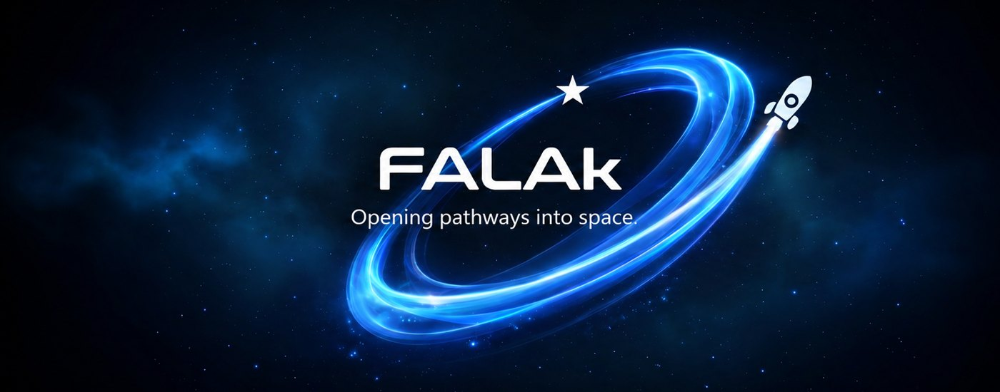
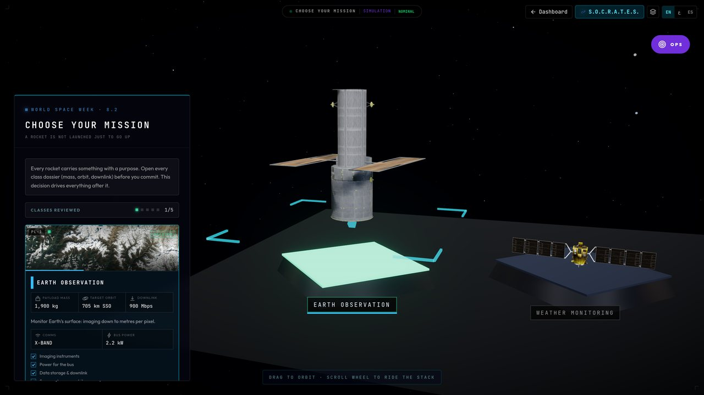
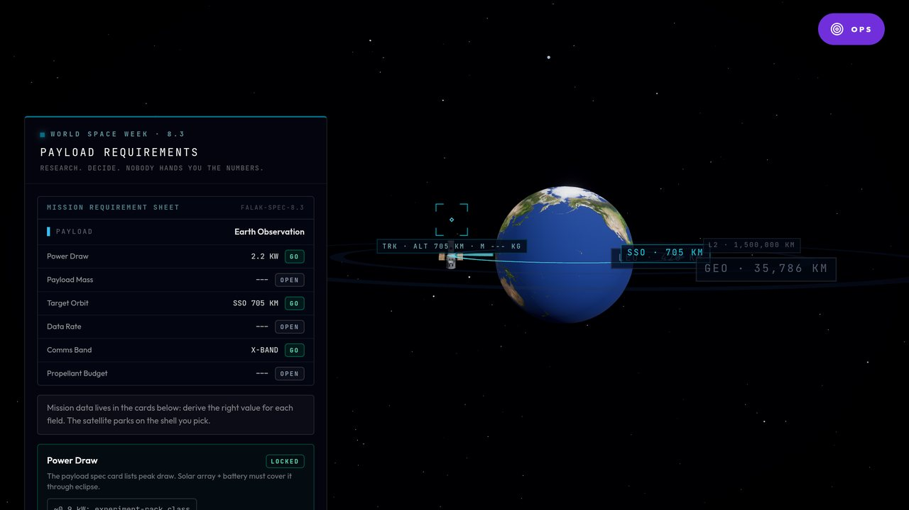
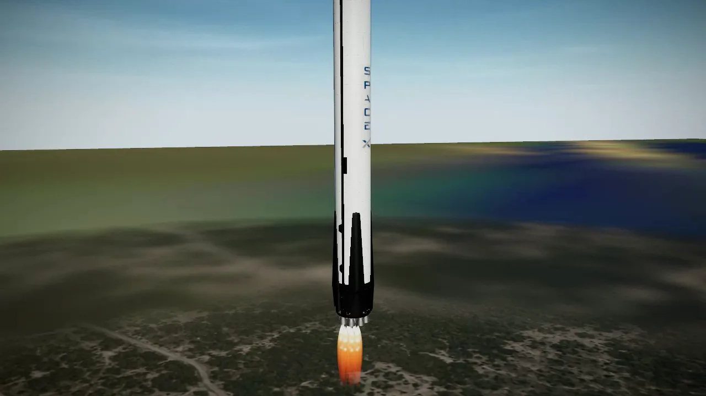

  

<h1 align="center">Adham Fouad</h1>

  <b>Founder, FALAk Platforms.</b> I build AI products and the commercial engine that sells them. 
  Abu Dhabi, UAE &nbsp;|&nbsp; Leeds, UK

  <a href="https://falakplatforms.co.uk"><b>falakplatforms.co.uk</b></a> &nbsp;|&nbsp;
  <a href="https://www.linkedin.com/in/adham-fouad-a0b24a237"><b>LinkedIn</b></a> &nbsp;|&nbsp;
  <a href="mailto:adhamfouad123@gmail.com"><b>adhamfouad123@gmail.com</b></a>

 

<table>
  <tr>
    <td align="center"><h2>176</h2>pilot sessions</td>
    <td align="center"><h2>0</h2>abandoned</td>
    <td align="center"><h2>1,914</h2>server-verified learning events</td>
    <td align="center"><h2>81 to 94%</h2>answer accuracy across the mission arc</td>
    <td align="center"><h2>460+</h2>merged pull requests, solo</td>
  </tr>
</table>

## FALAk SimLab

**A spaceflight academy that runs in a browser tab.** Learners pick a real mission, size the payload, configure
the rocket and fly the launch. An adaptive engine watches every decision and reshapes the next one, so no two
learners get the same mission. Built for space agencies, schools and training programmes across MENA, in
Arabic, English and Spanish.

<table>
  <tr>
    <td width="33%"></td>
    <td width="33%"></td>
    <td width="33%"></td>
  </tr>
  <tr>
    <td><b>1. Choose the mission.</b> Lesson 8.2: open each payload dossier and commit to an Earth-observation satellite.</td>
    <td><b>2. Derive the requirements.</b> Lesson 8.3: work out power, orbit and downlink. Nobody hands you the numbers.</td>
    <td><b>3. Fly it.</b> Lesson 8.8: the rocket you designed on day one launches on day two, and physics decides.</td>
  </tr>
</table>

Real captures from SimLab, not mock-ups. The source code is private; demo access on request.

### How every lesson adapts

<b>Calibrate &rarr; Learn &rarr; Simulate &rarr; Check &rarr; Debrief</b> 
Every decision and answer updates the learner model, and the model reshapes the next mission.

| Layer | What it does |
|---|---|
| **Adaptive engine** | Bayesian Knowledge Tracing per concept, forgetting curves and misconception tracking. A reason ledger tells learners and teachers *why* each adaptation happened. |
| **AI tutor** | S.O.C.R.A.T.E.S., a Socratic LLM tutor that works alongside five AI flight-controller agents and writes every prompt from the learner's own record. Its first version was a Llama 3.2 3B model I fine-tuned with LoRA. |
| **Curriculum** | 9 sections in three languages. The first framework was reviewed by the Head of Physics at the University of Leeds. |
| **For educators** | A console with cohort analytics and mission assignment. |
| **Stack** | TypeScript, React, Three.js / react-three-fiber, Zustand, Vite, Supabase (PostgreSQL, Edge Functions), Groq and Ollama inference, Vitest, Playwright, Vercel |

## Where the work has taken me

- **Egyptian Space Agency:** secured a live SimLab demonstration.
- **Paradox (Egypt):** MOU partner for the World Space Week pilot. Paradox has taught 3,000+ learners across MENA.
- **Z.ai (GLM, HKEX: 2513):** business development for Middle East market entry. I join delegation meetings with Moro Hub (Digital DEWA), PureCS (PureHealth) and Open Innovation AI.
- **Malin Advisory:** HubSpot RevOps, working directly with the CEO across three client engagements, including a $1.68M dormant-deal pool.
- **Hub.xyz (Y Combinator S26):** AI training-data sourcing, including a $50M Fortune 500 LLM-data engagement.

## Mentors

- **Christopher Stott**, Founder and CEO, Lonestar Data Holdings
- **Morgan Khan**, former SpaceX, Blue Origin and U.S. Air Force

 

Off the keyboard: national go-kart driver for Egypt (FIA-sanctioned), UAE IAME Summer Series Vice Champion.

